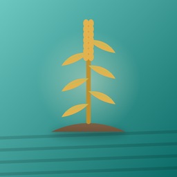
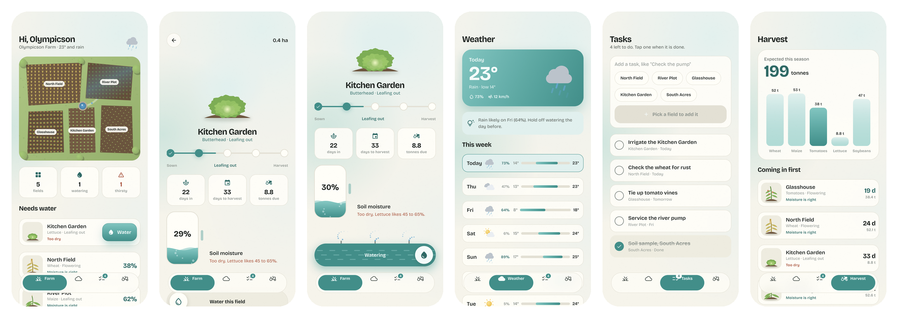
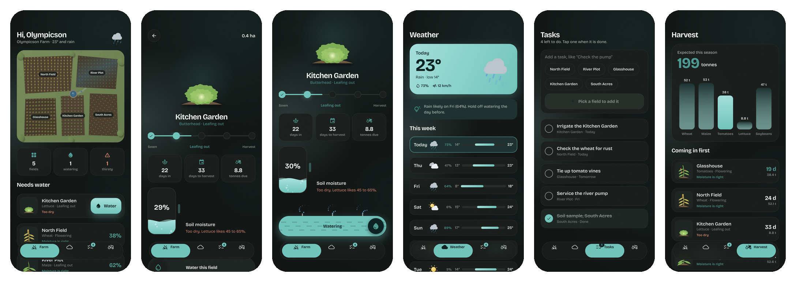

<p align="center">
  
</p>

<h1 align="center">Furrow</h1>

<p align="center">
  A Flutter smart farm app, drawn entirely in code. The whole farm grows up
  out of the soil on the map, water runs out to the fields you turn on, and
  the soil moisture tank fills while you watch.
</p>

<p align="center">
  <a href="https://flutterzip.com"></a>
  <a href="https://instagram.com/flutter_zip"></a>
  
  
  
  
  
</p>

<p align="center">
  
</p>
<p align="center">
  
</p>

## Highlights

- **A farm map with no images.** Five fields cut into the grass, each with
  its furrows at its own angle and its crop planted along them: wheat, maize,
  tomatoes, lettuce and soybeans, sized by how far each has grown. They grow
  up out of the soil when the map appears and sway after. Tap a field to
  open it.
- **Water you can see.** Turn a field on and a pipe runs out from the well
  with water pulsing along it, a sheen sweeps across the field, and its
  soil darkens as it gets wetter.
- **Plants up close.** Each crop is drawn at its stage: leaves unfold up the
  stem in turn, wheat comes into ear, a cob forms on the maize, tomatoes
  ripen, pods hang off the soy, and a lettuce opens ring by ring.
- **A moisture tank.** The level rises and falls to the soil's moisture, the
  surface rolls in two waves, bubbles rise, and the crop's target band is
  marked on the side. While a field is watered it fills live.
- **A water switch** whose knob springs across, with water running through
  the track and three sprinklers spraying above it.
- **Skies that move.** The sun's rays turn, clouds drift and rain falls, on
  today's card and on every day of the week. Pick a day and its high rolls
  to the new number digit by digit.
- **Tasks** that tick with a spring and strike through, swipe to delete with
  undo, harvest bars that grow up one after another, a splash where a wheat
  stalk grows out of the soil, and light and dark from one palette file.

## Try the demo

- On **Farm**, the Kitchen Garden is too dry: tap **Water**, or tap it on the
  map and use the switch. Leave it on and watch the tank reach the band.
- On **Weather**, tap the days of the week.
- On **Tasks**, tick one off, swipe one away and tap **Undo**, or add one.
- The round button on the right edge opens **Demo settings**: theme and
  reset demo data.

## Getting started

```bash
git clone https://github.com/flutterzip/furrow.git
cd furrow
flutter pub get
flutter run
```

Open a screen straight away: `--dart-define=startRoute=field` (also
`weather`, `tasks`, `harvest`). `--dart-define=timingScale=0` skips every
wait.

## Make it yours

| To change | Edit |
|---|---|
| Every colour, light and dark | `lib/config/palette.dart` |
| The colours of soil, grass, crops, water and sky | `lib/widgets/farm_colors.dart` |
| Fields: crop, size, shape on the map, moisture, target band | `assets/data/fields.json` |
| The farmer, the farm and the seeded tasks (days from today) | `assets/data/profile.json` |
| Crops, yields and growth stages | `Crop` and `Stage` in `lib/data/models.dart` |
| How fast watering raises moisture | `secondsPerPoint` in `lib/state/store.dart` |
| How each crop is drawn | `_PlantPainter` in `lib/widgets/farm.dart` |
| How things move | `lib/config/motion.dart` |
| The app's name and tagline | `lib/config/brand.dart` |

## Project structure

```
lib/
  config/     palette, theme, motion, timing, brand
  data/       fields, crops, stages, the forecast, tasks
  state/      the seed, watering and moisture, tasks (Riverpod, saved)
  widgets/    the farm map and plants, the tank, the switch, skies, bars;
              widgets.dart is one import for all
  screens/    farm, field, weather, tasks, harvest, shell, splash
  demo/       Demo settings button and launch hooks
```

## How it is built

Field shapes are polygons in 0 to 1 coordinates, so the map fits any width.
Each field is clipped to its shape, rotated to its row angle and filled
with furrows and plants, so no two fields look the same. Tapping the map
tests the tap against each polygon.

Watering stores only when the valve opened and how much earlier waterings
added. Moisture is worked out from that and the clock every second, so it
rises live, survives a restart, and stays put when the water goes off. The
forecast is generated from the date, so the week is stable through the day
and never goes stale.

## Testing

```bash
flutter analyze --fatal-infos
flutter test
```

17 tests cover growth and stages, moisture rising while watered and holding
after, the cap and the target band, tasks (tick, add, delete with undo,
sorting), a stable forecast, every screen, tapping a field on the map, the
switch bringing a field into range, and that no on-screen string has an em
dash. `tool/shots.sh` takes the README screenshots on the iOS simulator.

## Made by FlutterZip

A new Flutter UI every day. Follow [@flutter_zip](https://instagram.com/flutter_zip)
and find more at [flutterzip.com](https://flutterzip.com).

## Credits

- [Bricolage Grotesque](https://github.com/ateliertriay/bricolage) by
  Mathieu Triay, SIL Open Font License 1.1 (`assets/fonts/OFL.txt`).
- The farm, plants, tank, skies and icon are drawn in code for this
  project. The farm and its numbers are invented.

## License

MIT. See [LICENSE](LICENSE).
